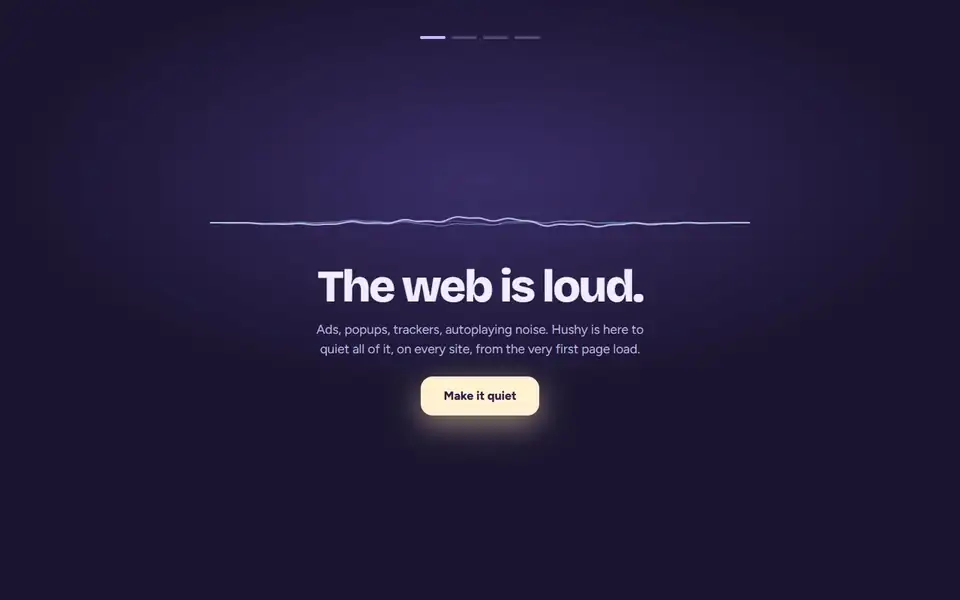
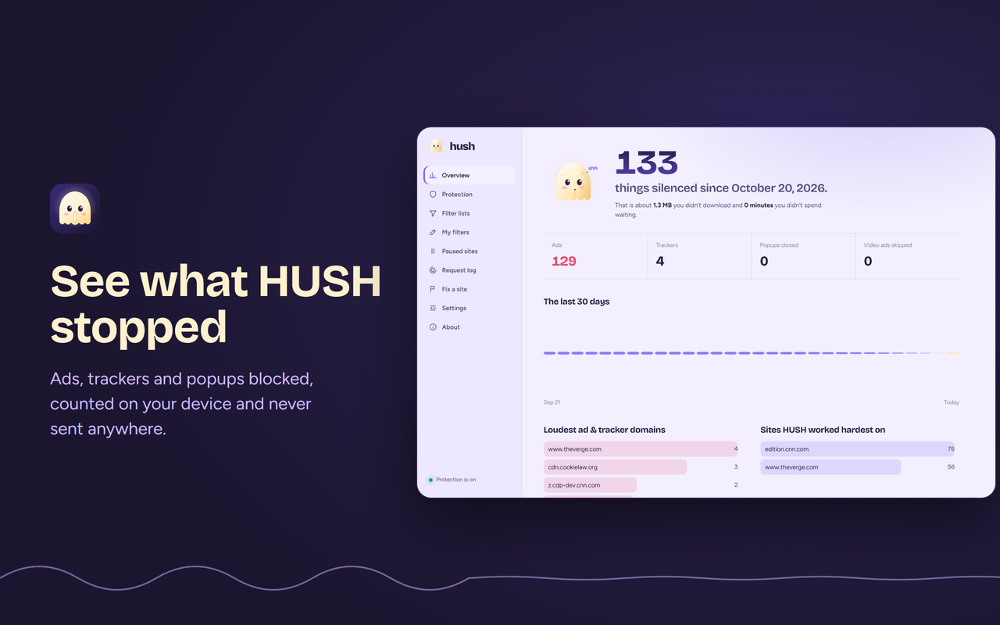
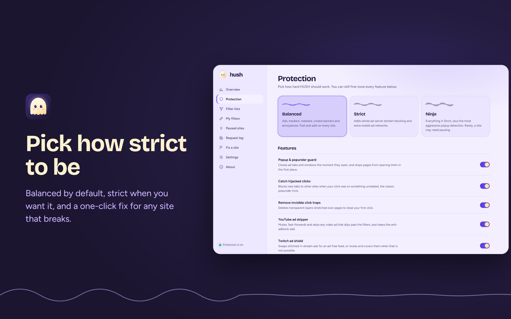
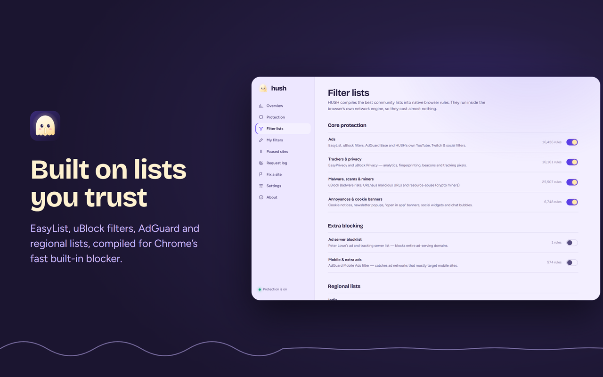
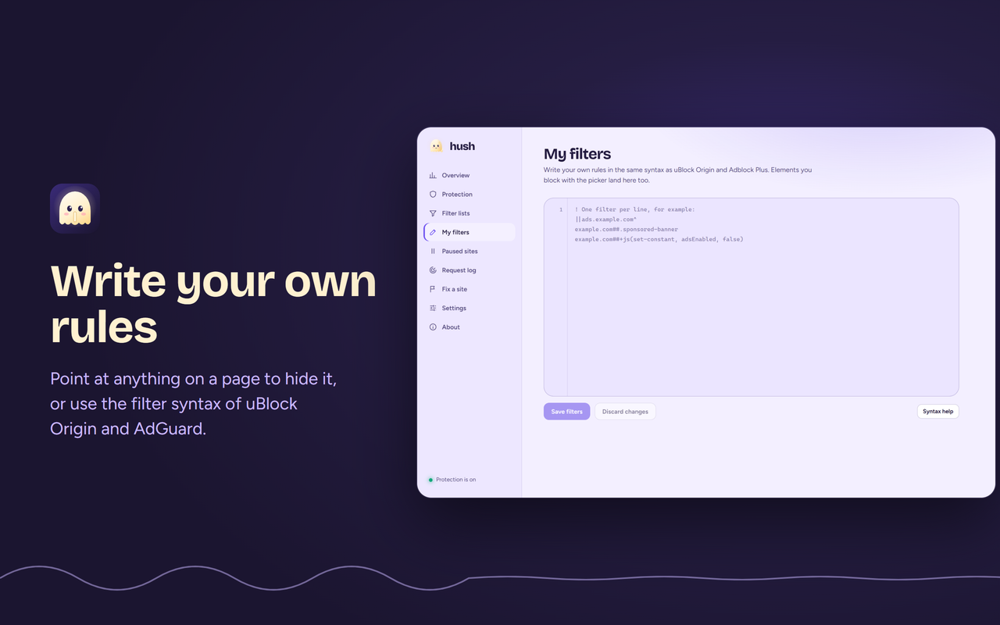
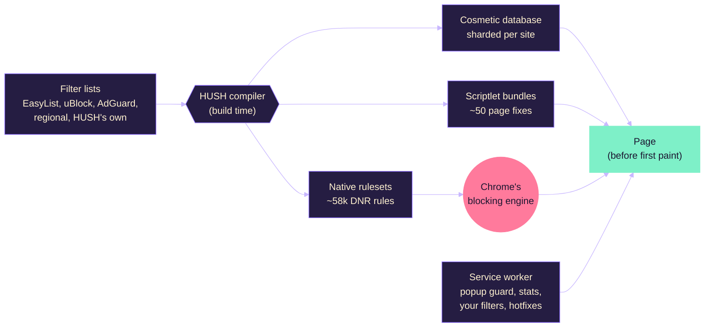

<div align="center">

<a href="#readme"></a>

<br>

<a href="https://github.com/mohitbansal25082006/HUSH/actions/workflows/ci.yml"></a>
<a href="https://github.com/mohitbansal25082006/HUSH/releases"></a>
<a href="LICENSE"></a>
<a href="https://adblock.turtlecute.org/"></a>
<br>


<a href="PRIVACY.md"></a>

<br><br>

**[Features](#what-hush-silences)** &nbsp;&nbsp; **[Demo](#see-it-work)** &nbsp;&nbsp; **[Install](#install)** &nbsp;&nbsp; **[How it works](#how-it-works)** &nbsp;&nbsp; **[FAQ](#questions)** &nbsp;&nbsp; **[Contributing](#contributing)**

</div>


<div align="center">

### The web is loud. HUSH turns it down.

HUSH blocks ads, popups, trackers, cookie banners and anti-adblock walls before they load. It needs no setup and collects no data, and Hushy, its moon-ghost, keeps you company.



</div>


## What HUSH silences



<details>
<summary><b>Read the full feature list</b></summary>
<br>

| | What HUSH does |
| :-- | :-- |
| **Ads and trackers** | Uses Chrome's native `declarativeNetRequest` engine with about 58,000 rules compiled from EasyList, EasyPrivacy, uBlock Origin filters, AdGuard, URLhaus and 7 regional lists. Blocking happens inside the browser, before a request leaves it. |
| **Leftover ad boxes** | Hides empty slots and sponsored posts with host-specific, generic and procedural filters (`:has-text`, `:upward`, `:xpath`…), applied before the first paint. |
| **Popups and popunders** | Closes ad tabs as they open, and stops `window.open` abuse, hijacked clicks and invisible click-trap overlays. |
| **YouTube** | Strips ads from the player data. Anything that slips through is muted and skipped, and the "ad blockers are not allowed" dialog is removed. |
| **Twitch** | Swaps stream ads for an ad-free feed, or mutes and covers them when that isn't possible. |
| **Cookie banners** | Clicks "reject" for you on about 30 consent platforms, and hides what's left. |
| **Anti-adblock walls** | About 50 scriptlets in uBlock Origin syntax, plus harmless stand-ins for blocked ad SDKs (Google IMA, adsbygoogle, GPT, BlockAdBlock, FingerprintJS, VAST/VMAP), so pages and video players keep working. |
| **Clean links** | Removes `utm_*`, `fbclid`, `gclid` and other tracking parameters from links you open. |
| **Malware shield** | Replaces known malware and phishing pages with a clear warning. |
| **Your own tools** | Element picker, one-time zapper, your own filters, paused sites, a live request log and a one-click "fix this site". |
| **Hotfixes** | Optional signed filter updates (ECDSA P-256) for fixes between releases. Off by default. |

</details>


## See it work

<div align="center">



<sub>A real recording of HUSH 1.0.0 on cnn.com and theverge.com. Nothing is staged.</sub>

<br><br>

<table>
  <tr>
    <td></td>
    <td></td>
  </tr>
  <tr>
    <td></td>
    <td></td>
  </tr>
</table>

</div>


## Install

<a href="https://github.com/mohitbansal25082006/HUSH/releases/latest"></a>
<a href="https://github.com/mohitbansal25082006/HUSH/releases/latest"></a>

**From a release:**

1. Download `hush-1.0.0-chrome.zip` from [the latest release](https://github.com/mohitbansal25082006/HUSH/releases/latest) and unzip it.
2. Open `chrome://extensions`. In Brave, open `brave://extensions`; in Edge, `edge://extensions`.
3. Turn on **Developer mode**, click **Load unpacked** and choose the unzipped folder.
4. Pin HUSH from the puzzle-piece menu. Hushy says hello, and you're protected.

<details>
<summary><b>Build from source</b></summary>
<br>

You need [Node.js](https://nodejs.org/) 22 or newer.

```bash
git clone https://github.com/mohitbansal25082006/HUSH.git
cd HUSH
npm install
npx playwright install chromium   # the filter compiler and tests use it
npm run filters                    # download and compile the filter lists (about a minute)
npm run build                      # the extension is written to .output/chrome-mv3
```

Load `.output/chrome-mv3` with **Load unpacked**. After every rebuild, click reload ↻ on the HUSH card.

| Command | What it does |
| :-- | :-- |
| `npm run dev` | Rebuild on every change (load `.output/chrome-mv3-dev` once) |
| `npm run filters:offline` | Recompile from the cached lists without downloading |
| `npm test` | Unit tests for the filter parser |
| `npm run test:e2e` | End-to-end tests in Chromium with the built extension |
| `npm run test:live` | Checks on real sites: the benchmark, YouTube, Twitch and a news site |
| `npm run check` | Type check |
| `npm run release` | Fresh lists, icons, build and the store zip in `.output/` |
| `npm run store:assets` | Render the Chrome Web Store screenshots and promo tiles |
| `npm run readme:assets` | Render the animated README artwork and the demo recording |

</details>


## How it works



- **At build time**, the compiler turns hundreds of thousands of list filters into Chrome's native rule format. It checks every regex against a real Chromium, so Chrome never skips a rule.
- **In the browser**, Chrome's own engine blocks requests. HUSH never sees your traffic, and pages pay no JavaScript cost for blocking.
- **On the page**, cosmetic CSS lands before the first paint, and scriptlets run before the site's own scripts.

<details>
<summary><b>Project layout</b></summary>
<br>

```
compiler/            filter list sources and compiler (lists → DNR rulesets, cosmetic DB, scriptlet bundles)
filters/hush.txt     HUSH's own filters (YouTube, Twitch, social, popunder networks, site fixes)
src/filters/         shared filter parser (build time and runtime), redirect map, cosmetic DB
src/scriptlets/      scriptlet library (self-contained functions injected into pages)
src/background/      service worker: rules, cosmetic store, scriptlets, stats, popup guard, hotfixes
src/content/         procedural cosmetics, cookie auto-reject, overlay killer
entrypoints/         WXT entrypoints: background, content scripts, popup, dashboard, onboarding, warning page
src/ui/              Svelte 5 UI, "Dusk" design tokens, Hushy and the other animated components
public/              icons, fonts and redirect resources (generated rulesets are git-ignored)
docs/readme/         the animated artwork on this page
store/               Chrome Web Store listing text and images
tests/               Vitest unit tests and Playwright end-to-end / live tests
```

**Built with:** [WXT](https://wxt.dev), [Svelte 5](https://svelte.dev), [GSAP](https://gsap.com), TypeScript, Vitest and Playwright.

</details>

<details>
<summary><b>Hotfixes, for maintainers</b></summary>
<br>

Hotfixes are signed filter text, never code: they're compiled as untrusted, so they can't use scriptlets that carry code.

```bash
npm run hotfix:keys                          # once: keys/hotfix-private.jwk (never commit) + src/shared/hotfix-key.ts
npm run hotfix:sign -- hotfix/filters.txt    # writes hotfix/hotfix.json
npm run hotfix:serve                         # serves it at http://localhost:8787/hotfix.json
```

Set the address in **Dashboard → Filter lists → Hotfix address**.

</details>


## Privacy

HUSH has no accounts, analytics or ads, and makes no network requests of its own. Your statistics stay in your browser. Read the full [privacy policy](PRIVACY.md).

<details>
<summary><b>Why HUSH asks for each permission</b></summary>
<br>

| Permission | Why |
| :-- | :-- |
| Access to all sites | Ads and trackers appear on every site, so HUSH must be able to clean any page you visit. |
| `declarativeNetRequest` | Chrome's built-in blocker: rules run inside the browser and HUSH never sees your traffic. |
| `scripting` | Runs the bundled page fixes that defeat popunders and anti-adblock walls. |
| `webRequest` | Counts blocked requests for the badge and the dashboard. It only observes. |
| `tabs`, `webNavigation` | Closes popunder tabs, and shows statistics for the current tab. |
| `storage`, `unlimitedStorage` | Keeps your settings, statistics and the compiled filter data on your device. |
| `alarms` | Schedules the optional hotfix check. |
| `contextMenus` | Adds "Block element" and "Pause HUSH on this site" to the right-click menu. |

</details>


## Questions

<details>
<summary><b>Does HUSH work in Brave and Edge?</b></summary>
<br>
Yes. HUSH is built for any Chromium browser running version 122 or newer. In Brave, it works with Shields on or off.
</details>

<details>
<summary><b>Will it slow my browser down?</b></summary>
<br>
No. Blocking is done by Chrome's native engine, which is the fastest way an extension can block. The service worker sleeps when it isn't needed, and pages usually load faster, because the ads never download.
</details>

<details>
<summary><b>A site broke. What do I do?</b></summary>
<br>
Click the HUSH icon, then <b>Site broken?</b>. <b>Relax on this site</b> keeps blocking but turns off page fixes; <b>Pause</b> turns HUSH off there completely. <b>Copy report</b> gives you a ready-made report for <a href="https://github.com/mohitbansal25082006/HUSH/issues/new/choose">an issue</a>.
</details>

<details>
<summary><b>Does HUSH block YouTube ads?</b></summary>
<br>
Yes. Ads are removed from the player data, and any that appear anyway are muted and skipped. YouTube changes often, so if an ad gets through, please <a href="https://github.com/mohitbansal25082006/HUSH/issues/new/choose">report it</a>.
</details>

<details>
<summary><b>Why does HUSH need access to every site?</b></summary>
<br>
Ads appear on every site. HUSH uses that access only to block and hide them on your device. Nothing is sent anywhere.
</details>

<details>
<summary><b>Is it really free?</b></summary>
<br>
Yes. HUSH is free and open source under the GPL-3.0, with no premium tier, no "acceptable ads" programme and no tracking.
</details>


## Contributing

Ads change every day, and reports are the most useful help:

- **An ad slipped through, or a site broke:** open a [site problem](https://github.com/mohitbansal25082006/HUSH/issues/new/choose) issue, and paste the report from **Site broken? → Copy report**.
- **You want to fix it yourself:** most fixes are one line in [`filters/hush.txt`](filters/hush.txt). See [CONTRIBUTING.md](CONTRIBUTING.md).
- **You found a security problem:** please follow [SECURITY.md](SECURITY.md) instead of opening an issue.

## Credits

HUSH stands on the work of the filter list communities: **EasyList and EasyPrivacy**, **uBlock Origin** (Raymond Hill and volunteers), **AdGuard**, **Peter Lowe's list**, **URLhaus** (abuse.ch), and the regional list maintainers. Fonts: **Bricolage Grotesque** and **Figtree** (SIL OFL). Animation: **GSAP**.

## License

HUSH is free software under the [GNU General Public License v3.0 or later](LICENSE). The bundled filter lists keep their own licenses, which are listed on the dashboard's About page.

<div align="center">
<br>

<br>
<sub><b>shh…</b> made by <a href="https://github.com/mohitbansal25082006">@mohitbansal25082006</a>. If HUSH made your web quieter, a ⭐ helps others find it.</sub>
</div>
